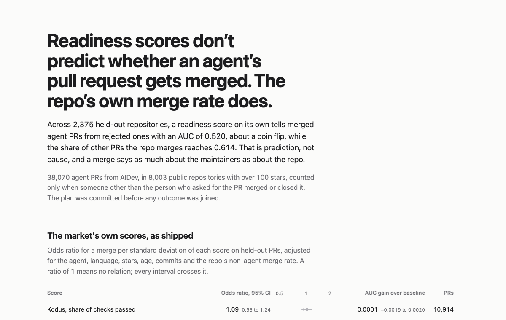

# landable

Readiness scores, ours and the market's, don't predict whether an agent's pull request gets merged, and the repo's own merge rate does. That comes from 38,070 real agent PRs and it is prediction, not cause: a merge says as much about the maintainers as about the repo.

[](https://landable.abhays-account.workers.dev)

**[Check a repo and read the full table](https://landable.abhays-account.workers.dev)**

## The two numbers

On 2,375 held-out repositories:

| | Result |
|---|---|
| A readiness score alone, against the repo's non-agent merge rate alone | AUC 0.520 against 0.614, difference -0.094 [95% CI -0.143, -0.046] |
| The market's scores as shipped: Kodus pass share, Agent Friendly Code overall | odds ratio per SD 1.09 [0.95, 1.24] and 1.04 [0.91, 1.19], adjusted for the baseline |

Every item from both checklists was tested on its own, 63 of 69 had enough spread to test, and two survived: an agent instructions file as Kodus defines it (CLAUDE.md, `.cursorrules`, copilot instructions; held-out odds ratio 1.43 [1.12, 1.82]) and Agent Friendly Code's AGENTS.md signal (1.16 [1.04, 1.29] per SD). Together they still add nothing measurable: held-out AUC goes from 0.668 to 0.674, a gain of 0.006 [-0.002, 0.014]. CI on pull requests, a one-command test run, linting, type checking, PR templates and CODEOWNERS predicted nothing.

## Limits

- Merges reflect maintainers. The strongest predictor is how often the repo merges its other PRs, which points at the people more than the files.
- Repos that already use agents well may be the ones that add CLAUDE.md, so even the two surviving items may run backwards.
- The sample is AIDev v5: public repos over 100 stars and five agents (Claude Code, Copilot, Codex, Cursor, Devin). Only PRs that someone other than the requester merged or closed count, since a self-merge says little about the repo.
- CI outcomes come from a 5,000-PR sample and are exploratory, like the review-speed and all-decisions outcomes in the report.

## Check a repo

On the [page](https://landable.abhays-account.workers.dev), in your browser, with the same scorer as the CLI. From a terminal:

```bash
npx landable astral-sh/ruff     # any public GitHub repo, read with a blobless git fetch
npx landable . --json           # a local checkout
```

`npm install -g landable` keeps it around. It needs Node 20 or later and git.

Each item prints its value and the file that is its evidence. The JSON endpoint is `https://landable.abhays-account.workers.dev/api/score?repo=owner/name`. It runs on Cloudflare's free tier, so GitHub's anonymous API limit there is shared and it may answer 503 (send any User-Agent; Cloudflare turns away Python's default one). The page and the CLI do not have that problem. On 20 repos the endpoint and the CLI agreed on every item, its evidence and the market scores ([analysis/agreement-local.md](analysis/agreement-local.md)).

## The study

- [`PREREGISTRATION.md`](PREREGISTRATION.md): the plan, committed (tag `prereg-v1`) before any outcome was joined, with dated deviations at the end.
- [`analysis/report.md`](analysis/report.md): every number above, regenerated byte for byte by `study/analyze.py` from the frozen files in `data/`.
- [`study/item-pool-sources.md`](study/item-pool-sources.md): where each Kodus and Agent Friendly Code rule comes from, by commit and line.
- [`AGENTS.md`](AGENTS.md): layout, commands and the rules for changing anything.

Data from [AIDev](https://huggingface.co/datasets/hao-li/AIDev) v5 (CC BY 4.0). Code MIT; the Kodus and Agent Friendly Code item rules follow their MIT sources.
